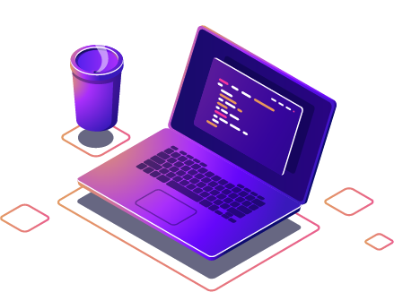
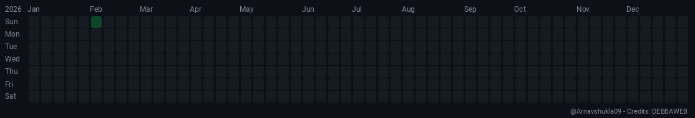

<div align="center">
  <h1>Arnav Shukla</h1>
  <p><b>Systems &amp; Applied AI Engineer</b> &nbsp;|&nbsp; <i>Building production-grade software at the intersection of AI &amp; Backend</i></p>
  
  <p>
    <a href="https://komarev.com/ghpvc/?username=Arnavshukla09&label=Profile%20views&color=38bdf8&style=for-the-badge"></a>
    <a href="https://github.com/Arnavshukla09?tab=followers"></a>
    <a href="https://github.com/Arnavshukla09?tab=repositories"></a>
  </p>
</div>


## About Me

<table bordercolor="#161b22">
<tr>
<td width="62%" valign="top">

```shell
arnav@shukla:~$ cat profile.json
{
  "name": "Arnav Shukla",
  "location": "Indore, India 🇮🇳",
  "university": "VIT Bhopal University (2027)",
  "role": "Systems & Applied AI Engineer",
  "focus": ["AI Systems", "Backend", "Distributed Systems"]
}

arnav@shukla:~$ ./execute_initiatives.sh
> ⚙️ Architecting scalable backends & distributed systems.
> 🧠 Integrating LLMs (MCP, RAG) into real-world tasks.
> ⚡ Benchmarking performance & latency of deployed models.
> 🔒 Designing secure multi-tenant DBs with Row-Level Sec.
> 💬 Ask about FastAPI, Next.js, Postgres, WebSockets.
```

</td>
<td width="38%" valign="middle" align="center">



</td>
</tr>
</table>


## Achievements at a Glance

<div align="center">
  <table bordercolor="#161b22">
    <tr>
      <td align="left">
        <ul>
          <li>🏅 <b>Honeywell Hackathon:</b> Round 1 Shortlist — Eco-Loop AI</li>
          <li>🥈 <b>SIH 2025:</b> Pitched HealthSeva AI at College Round</li>
          <li>🤖 <b>IBM Call for Code:</b> Winner — AI Knowledge Challenge</li>
        </ul>
      </td>
    </tr>
  </table>
</div>


## Tech Stack

### Languages
<p align="left">
  
  
  
  
  
  
</p>

### Frontend
<p align="left">
  
  
  
  
  
</p>

### Backend
<p align="left">
  
  
  
  
  
</p>

### Database
<p align="left">
  
  
  
  
  
  
</p>

### Cloud & AI
<p align="left">
  
  
  
  
  
  
</p>


## Featured Projects

<table bordercolor="#161b22">
  <tr>
    <td width="50%" valign="top">
      <b>🏥 Rural Healthcare Platform</b><br/>
      <i>Offline-First Mobile PWA for Rural Healthcare Delivery</i><br/><br/>
      <code>Next.js 15</code> <code>PostgreSQL 17</code> <code>PostGIS</code> <code>WebRTC</code> <code>FHIR R4</code>
      <br/><br/>
      <ul>
        <li><b>Offline-First Resilience:</b> Idempotent mutation queue via IndexedDB with automatic background synchronization.</li>
        <li><b>Geospatial Discovery:</b> Sub-second facility search via PostGIS GIST spatial indexing.</li>
        <li><b>Cryptographic Security:</b> Strict PostgreSQL Row-Level Security (RLS) scoped to verified doctor-patient care relationships.</li>
        <li><b>Telehealth &amp; Standards:</b> Zero-install WebRTC consultations and ABDM-compliant HL7 FHIR R4 clinical exports.</li>
      </ul>
      <div align="left">
        <a href="https://github.com/Arnavshukla09/RURAL-HEALTHCARE-PLATFORM"></a>
        <a href="https://rural-healthcare-platform.vercel.app/" target="_blank"></a>
      </div>
    </td>
    <td width="50%" valign="top">
      <b>♻️ Eco-Loop Building Agents</b><br/>
      <i>Autonomous Physical AI for Smart HVAC Optimization</i><br/><br/>
      <code>Python</code> <code>FastAPI</code> <code>EnergyPlus</code> <code>FastMCP</code> <code>Qwen2.5</code> <code>React</code>
      <br/><br/>
      <ul>
        <li><b>Demonstrated Savings:</b> 45% HVAC energy savings with zero thermal comfort violations across 5 building zones.</li>
        <li><b>MCP Agent Architecture:</b> 10-tool Model Context Protocol server exposing sensors and actuators to local LLMs.</li>
        <li><b>Closed-Loop Control:</b> Autonomous 30-second setpoint control with safe deadbands and rule-based failover.</li>
        <li><b>Real-Time Telemetry:</b> Live reactive React dashboard streaming thermal physics over WebSockets.</li>
      </ul>
      <div align="left">
        <a href="https://github.com/Arnavshukla09/Eco_Loop_Building_Agents"></a>
      </div>
    </td>
  </tr>
  <tr>
    <td width="50%" valign="top">
      <b>📄 TalentMatch AI v2</b><br/>
      <i>High-Throughput Resume Ranking Engine — Deterministic C++</i><br/><br/>
      <code>C++</code> <code>FastAPI</code> <code>XGBoost</code> <code>Aho-Corasick</code> <code>BM25</code> <code>Docker</code>
      <br/><br/>
      <ul>
        <li><b>Deterministic Scoring:</b> ~85 engineered features computed natively in C++ for reproducible, hallucination-free scoring.</li>
        <li><b>High Throughput:</b> Sub-25ms inference throughput with zero external API key or hosted LLM dependency.</li>
        <li><b>Multi-Stage Docker:</b> Pre-baked sentence-transformers and native compiled C++ binary in an environment-isolated container.</li>
        <li><b>Chrome Extension:</b> Shipped 21.8KB vanilla-JS browser extension for 1-click job description scraping.</li>
      </ul>
      <div align="left">
        <a href="https://github.com/Arnavshukla09/talentmatch-ai"></a>
        <a href="https://talentmatch-ai-jwqd.onrender.com/" target="_blank"></a>
      </div>
    </td>
    <td width="50%" valign="top">
      <b>🛒 CampusCart</b><br/>
      <i>Campus Service Management &amp; Commerce Platform</i><br/><br/>
      <code>Python</code> <code>Flask</code> <code>SQLAlchemy</code> <code>SQLite</code> <code>Blueprints</code> <code>RBAC</code>
      <br/><br/>
      <ul>
        <li><b>Multi-Role Architecture:</b> 3-tier Role-Based Access Control connecting Students, Vendors, and Administrators.</li>
        <li><b>Lifecycle &amp; Wallet:</b> Integrated Campus Wallet and COD checkout with full order tracking (Pending → Completed).</li>
        <li><b>Printing Service Pipeline:</b> Server-side validated file upload system for on-demand campus document printing.</li>
        <li><b>Vendor Analytics:</b> Vendor-scoped catalog management with per-vendor revenue and star rating dashboards.</li>
      </ul>
      <div align="left">
        <a href="https://github.com/Arnavshukla09/Student-Service-Portal---CampusCart"></a>
        <a href="https://campuscart-bq5r.onrender.com/" target="_blank"></a>
      </div>
    </td>
  </tr>
</table>


## GitHub & LeetCode Stats

<p align="center">
  <a href="https://github.com/Arnavshukla09" target="_blank"></a>
  <a href="https://leetcode.com/u/Arnavshukla09/" target="_blank"></a>
</p>

<br/>

## Contribution Blocks

<div align="center">
  
</div>


## Let's Connect

<p align="center">
  <a href="https://linkedin.com/in/arnavshukla09/" target="_blank"></a>
  <a href="mailto:arnavshukla0925@gmail.com"></a>
  <a href="https://arnav-shukla.vercel.app/" target="_blank"></a>
  <a href="https://leetcode.com/u/Arnavshukla09/" target="_blank"></a>
</p>

<br/>
