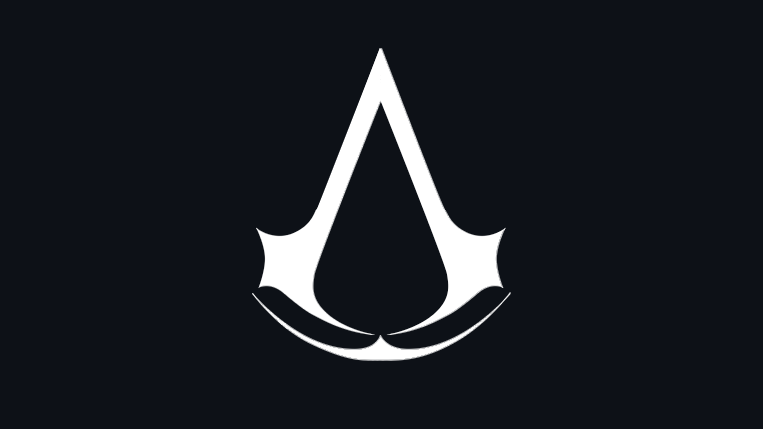
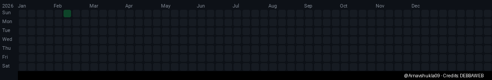

<div align="center">
  <h1>Arnav Shukla</h1>
  <p>
    <b>Systems &amp; Applied AI Engineer</b><br/>
    <i>Building production-grade software at the intersection of AI &amp; Backend</i>
  </p>
</div>

<div align="center">
  
</div>

<br/>

<p align="center">
  <a href="https://komarev.com/ghpvc/?username=Arnavshukla09&label=Profile%20views&color=38bdf8&style=for-the-badge"></a>
  <a href="https://github.com/Arnavshukla09?tab=followers"></a>
  <a href="https://github.com/Arnavshukla09?tab=repositories"></a>
</p>


## About Me

<table bordercolor="#161b22">
<tr>
<td width="62%" valign="top">

```shell
arnav@shukla:~$ cat profile.json
{
  "name": "Arnav Shukla",
  "location": "Indore, India 🇮🇳",
  "university": "VIT Bhopal University (2027)",
  "role": "Systems & Applied AI Engineer",
  "focus": ["AI Systems", "Backend", "Distributed Systems"]
}

arnav@shukla:~$ ./execute_initiatives.sh
> ⚙️ Architecting scalable backends & distributed systems.
> 🧠 Integrating LLMs (MCP, RAG) into real-world tasks.
> ⚡ Benchmarking performance & latency of deployed models.
> 🔒 Designing secure multi-tenant DBs with Row-Level Sec.
> 💬 Ask about FastAPI, Next.js, Postgres, WebSockets.
```

</td>
<td width="38%" valign="middle" align="center">



</td>
</tr>
</table>


## Achievements at a Glance

<div align="center">
  <table bordercolor="#161b22">
    <tr>
      <td align="left">
        <ul>
          <li>🏅 <b>Honeywell Hackathon:</b> Round 1 Shortlist — Eco-Loop AI</li>
          <li>🥈 <b>SIH 2025:</b> Pitched HealthSeva AI at College Round</li>
          <li>🤖 <b>IBM Call for Code:</b> Winner — AI Knowledge Challenge</li>
        </ul>
      </td>
    </tr>
  </table>
</div>


## Tech Stack

### Languages
<p align="left">
  
  
  
  
  
  
</p>

### Frontend
<p align="left">
  
  
  
  
  
</p>

### Backend
<p align="left">
  
  
  
  
  
</p>

### Database
<p align="left">
  
  
  
  
  
  
</p>

### Cloud & AI
<p align="left">
  
  
  
  
  
  
</p>


## GitHub & LeetCode Stats

<p align="center">
  <a href="https://github.com/Arnavshukla09" target="_blank"></a>
  <a href="https://leetcode.com/u/Arnavshukla09/" target="_blank"></a>
</p>

<br/>

## Contribution Blocks

<div align="center">
  
</div>


## Let's Connect

<p align="center">
  <a href="https://linkedin.com/in/arnavshukla09/" target="_blank"></a>
  <a href="mailto:arnavshukla0925@gmail.com"></a>
  <a href="https://arnav-shukla.vercel.app/" target="_blank"></a>
  <a href="https://leetcode.com/u/Arnavshukla09/" target="_blank"></a>
</p>

<br/>
